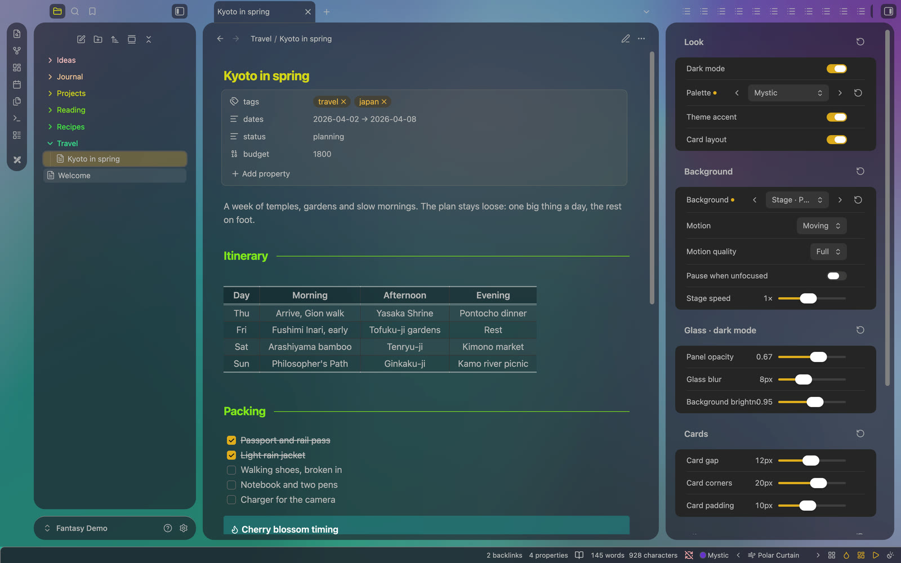

# Fantasy Easel

**Your wallpaper, still or moving, behind glass panels.** The companion plugin for the [Fantasy](https://github.com/especialkim/obsidian-theme-fantasy) theme: palettes, wallpapers and glass styles, set in a few clicks.

**No setup needed.** Fantasy already looks complete on its own. Easel is optional: turn it on when you want to change the look, and everything stays in one sidebar tab.



## Features

- **Six palettes:** Graphite, Sky, Ocean, Emerald, Mystic and Orchid tint the glass, the wallpaper and the accent.
- **Wallpapers, still and moving:** CSS gradients, slow media-art motion, 19 four-layer "stage" scenes, and your own pictures (a vault image, a web address, or a file on this computer).
- **Style panel** (command *Open style panel*): the main switches plus sliders for glass opacity, blur and brightness (kept per dark and light mode), card gap, corners and padding, note width, heading size and paragraph spacing. Every value has a reset.
- **Gallery:** every wallpaper under a glass card that follows your settings.
- **Plugin styles:** Dataview, Kanban and Excalidraw fitted to the glass, each part on or off.
- **Motion:** Moving, Follow system (still when *Reduce motion* is on), or Still. *Motion quality* Light draws moving wallpapers with less GPU work (the default on Windows).
- **Status bar:** palette, previous and next wallpaper, gallery, accent, cards, motion and dark or light, in the order you choose.

## Screenshots


| Style panel in light mode | Kanban, Dataview and Excalidraw |
| --- | --- |
|  |  |

## Install

- **Community plugins:** Settings → Community plugins → Browse → search "Fantasy Easel" → Install, then Enable. You also need the [Fantasy](https://github.com/especialkim/obsidian-theme-fantasy) theme.
- **Manual:** copy `manifest.json`, `main.js` and `styles.css` into `<vault>/.obsidian/plugins/fantasy-easel/`, then turn on **Fantasy Easel** in Settings → Community plugins.

Desktop only, Obsidian 1.13 or later. With any other theme the plugin stays idle and switches on by itself when Fantasy is chosen.

**Excalidraw:** for the see-through canvas, let Easel match the Excalidraw settings it needs (it asks first and can restore them), and give a drawing a transparent background in Excalidraw.

## Disclosures

- **Network use:** a picture you add as a web address (`https://…`) is loaded from that site. Nothing else goes over the network; the built-in wallpapers are CSS only.
- **Files outside the vault:** a picture you add as `file://…` or an absolute path is read from that place on your computer, only to show it as the wallpaper. It works only on that computer; vault pictures work wherever the vault is.

**Add picture** saves an optional alias and path or URL with **Use** off. Turn **Use** on in **Your pictures** to validate the image (up to 10 seconds). Only successful checks add it to background dropdowns, the gallery and previous/next cycling; the current background stays unchanged. A failed check leaves **Use** off and shows a notice plus an error below the compact picture row. **Apply** selects an enabled picture as the current background; a small check marks it.

If an enabled picture later fails when selected/cycled to, or the current picture becomes unavailable, Easel selects the default Silk background, turns **Use** off and explains that in a notice. Turning **Use** off also selects Silk if that picture was current. Saved picture entries stay in the list. Editing a path turns **Use** off so the new path must be validated again. Vault file changes and returning to the Obsidian window recheck the current picture automatically.

Older entries without **Use** preserve the current picture as enabled; other saved entries start disabled. Aliases and paths are retained.

## Develop

```bash
npm install
npm run check   # TypeScript
npm test        # selftest against the Fantasy theme: FANTASY_THEME=<path to theme.css> (skipped if not found)
npm run build   # writes the generated parts of styles.css and main.js
```

- `src/backgrounds.ts`, `src/stages.ts`: wallpaper sources. `styles.css` blocks marked "generated" are written by the build.
- `skins/<id>.css`: plugin styles, split into parts by `/* part: <part> — … */` comments; the build puts every selector of a part behind `body.fantasy-easel-skin-<id>-<part>` (parts listed in `src/skins.ts`).

## Support

Fantasy Easel is made and kept up to date by one person. If it makes your notes a little nicer to look at, a coffee is a lovely way to say thanks.

<a href="https://buymeacoffee.com/yongminkiml"></a>

## License

[MIT](./LICENSE) © 2026 YongMin Kim
