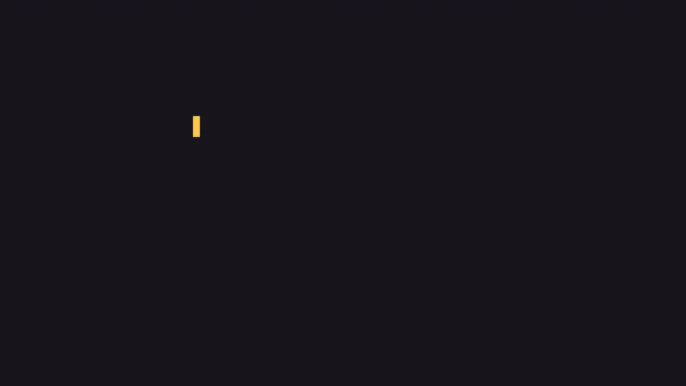
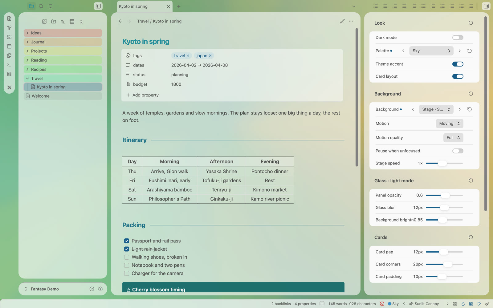
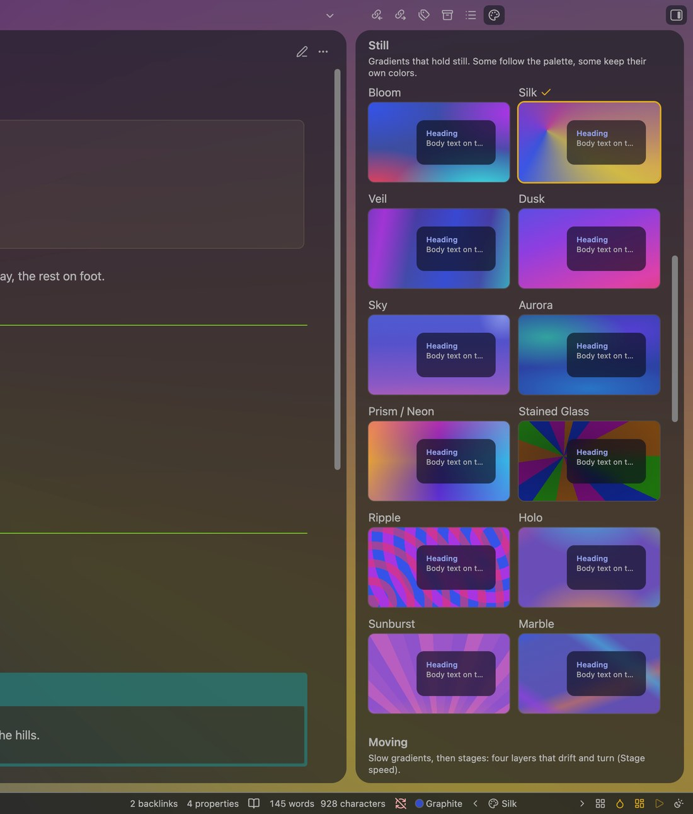
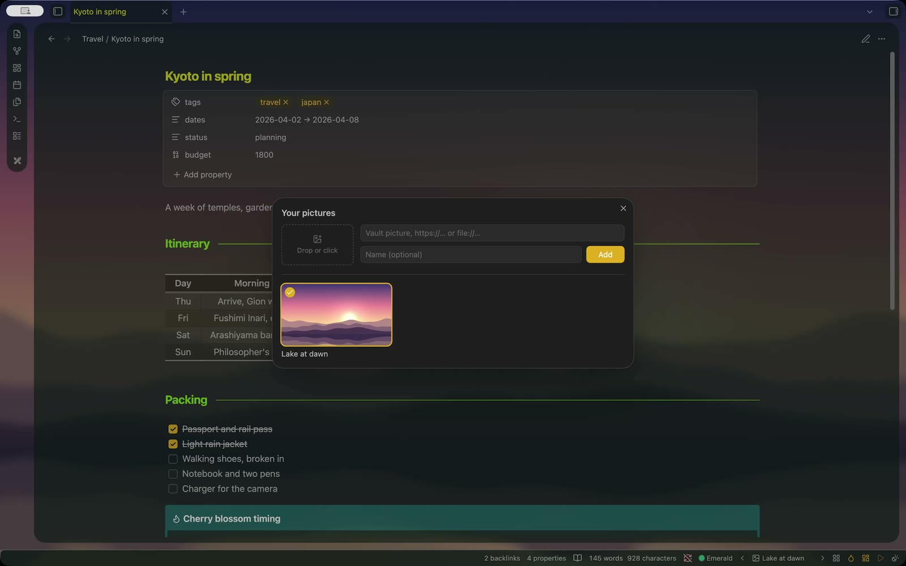
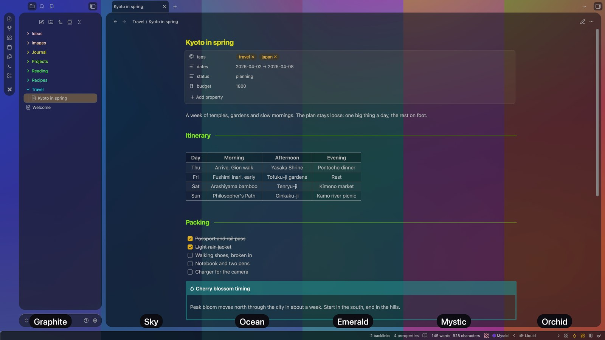
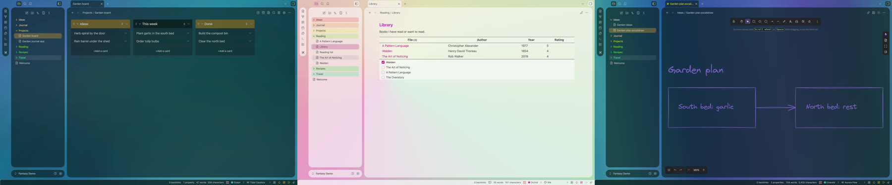

# Fantasy Easel

**Your wallpaper, still or moving, behind glass panels.** The companion plugin for the [Fantasy](https://github.com/especialkim/obsidian-theme-fantasy) theme: palettes, wallpapers and glass styles, set in a few clicks.

**No setup needed.** Fantasy already looks complete on its own. Easel is optional: turn it on when you want to change the look, and everything stays in one sidebar tab.



## Wallpapers that move

Three kinds of wallpaper, grouped the same way everywhere:

- **Still:** soft gradients. Some follow your palette, some keep their own colors.
- **Moving:** slow media-art gradients and 19 four-layer "stage" scenes that drift and turn.
- **Your pictures:** see below.

Motion is *Moving*, *Follow system* (still when *Reduce motion* is on) or *Still*. *Motion quality* Light draws moving wallpapers with less GPU work (the default on Windows). *Still* and *Pause when unfocused* save the most battery.

## One panel for every style

Command *Open style panel* opens a sidebar tab with the main switches (dark mode, palette, accent, cards, wallpaper, motion) and sliders for glass opacity, blur and brightness (kept per dark and light mode), card gap, corners and padding, note width, heading size and paragraph spacing. Every value has a reset.

The **gallery** sits at the bottom of the panel: every wallpaper under a glass card that follows your settings. Click one to use it.

| Style panel in light mode | Gallery in the panel |
| --- | --- |
|  |  |

## Your pictures

Drop a picture on the add box (in the panel, in Settings or in the *Your pictures* window), click it to choose files, or type a vault path, `https://…` or `file://…`. A new picture goes to the top and becomes the wallpaper.

- Files from Finder or Explorer are copied into the vault, to **Picture folder** (Settings) or your attachment folder, so they work on every device that has the vault.
- *Manage pictures…* (wallpaper menu in the status bar, or the command) opens a window to add, use and remove pictures. Removing one only takes it off the list; the file stays.



## Also

- **Six palettes:** Graphite, Sky, Ocean, Emerald, Mystic and Orchid tint the glass, the wallpaper and the accent.
- **Plugin styles:** Dataview, Kanban and Excalidraw fitted to the glass, each part on or off.
- **Status bar:** palette, previous and next wallpaper, gallery, accent, cards, motion and dark or light, in the order you choose.





## Tour

**A one-minute tour:** moving wallpapers, the style panel and your own pictures.

https://github.com/user-attachments/assets/a54df028-7295-4e57-8a49-508afce3441a

## Install

- **Community plugins:** Settings → Community plugins → Browse → search "Fantasy Easel" → Install, then Enable. You also need the [Fantasy](https://github.com/especialkim/obsidian-theme-fantasy) theme.
- **Manual:** copy `manifest.json`, `main.js` and `styles.css` into `<vault>/.obsidian/plugins/fantasy-easel/`, then turn on **Fantasy Easel** in Settings → Community plugins.

Desktop only, Obsidian 1.13 or later. With any other theme the plugin stays idle and switches on by itself when Fantasy is chosen.

**Excalidraw:** for the see-through canvas, let Easel match the Excalidraw settings it needs (it asks first and can restore them), and give a drawing a transparent background in Excalidraw.

## Disclosures

- **Network use:** a picture you add as a web address (`https://…`) is loaded from that site. Nothing else goes over the network; the built-in wallpapers are CSS only.
- **Files outside the vault:** a picture you add as `file://…` or an absolute path is read from that place on your computer, only to show it as the wallpaper. It works only on that computer; vault pictures work wherever the vault is.
- **Files written to the vault:** a picture you drop from Finder or Explorer (or choose with the file picker) is copied into the vault, to *Picture folder* or your attachment folder. Easel writes nothing else to your vault.

## Develop

```bash
npm install
npm run check   # TypeScript
npm test        # selftest against the Fantasy theme: FANTASY_THEME=<path to theme.css> (skipped if not found)
npm run build   # writes the generated parts of styles.css and main.js
```

- `src/backgrounds.ts`, `src/stages.ts`: wallpaper sources. `styles.css` blocks marked "generated" are written by the build.
- `skins/<id>.css`: plugin styles, split into parts by `/* part: <part> — … */` comments; the build puts every selector of a part behind `body.fantasy-easel-skin-<id>-<part>` (parts listed in `src/skins.ts`).

## Support

Fantasy Easel is made and kept up to date by one person. If it makes your notes a little nicer to look at, a coffee is a lovely way to say thanks.

<a href="https://buymeacoffee.com/yongminkiml"></a>

## License

[MIT](./LICENSE) © 2026 YongMin Kim
